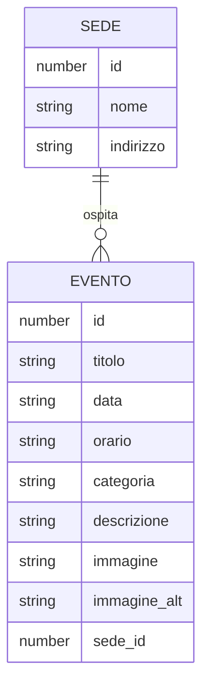

# Scheda dati — Segnale

## 1. Entità
Il modello dei dati del programma comprende due entità: **Sede** ed **Evento**.

## 2. Campi, tipi ed esempi

### Sede (`dati/sedi.json`)
- `id`: numero intero — identificativo univoco della sede (es. `1`)
- `nome`: testo — denominazione della sede nel festival (es. `"Officina Nord — Sede centrale"`)
- `indirizzo`: testo — indirizzo fisico a Torino (es. `"Corso Duca degli Abruzzi 24, Torino"`)

### Evento (`dati/eventi.json`)
- `id`: numero intero — identificativo univoco dell'evento (es. `1`)
- `titolo`: testo — titolo dell'appuntamento (es. `"Lettere in movimento"`)
- `data`: testo — data dell'evento in formato ISO `AAAA-MM-GG` (es. `"2026-06-12"`)
- `orario`: testo — ora di inizio in formato `HH:MM` (es. `"10:00"`)
- `categoria`: testo — tipologia di appuntamento (es. `"Incontro"`, `"Laboratorio"`, `"Mostra"`)
- `descrizione`: testo — breve presentazione dell'evento
- `immagine`: testo — percorso relativo dell'illustrazione associata (es. `"assets/lettere-in-movimento.svg"`)
- `immagine_alt`: testo — testo alternativo descrittivo dell'immagine
- `sede_id`: numero intero — riferimento alla sede in cui si svolge l'evento (es. `1`)

## 3. Chiavi primarie
- In **Sede**, la chiave primaria è `id` (numerico, univoco nell'entità e stabile).
- In **Evento**, la chiave primaria è `id` (numerico, univoco nell'entità e stabile).

## 4. Relazione
Una **Sede** può ospitare zero o più **Eventi**; ogni **Evento** si svolge in una sola **Sede**. Il collegamento avviene tramite la chiave esterna `Evento.sede_id` che fa riferimento a `Sede.id`.

## 5. Quantità
I dati attuali contengono **6 eventi** (`dati/eventi.json`) distribuiti su **3 sedi** (`dati/sedi.json`).

## 6. Chi aggiorna i dati e come
Chi gestisce il sito aggiorna i contenuti modificando direttamente i file `dati/eventi.json` e `dati/sedi.json` nella repository Git ed eseguendo il commit e il push per pubblicare le modifiche su GitHub Pages.

## 7. Che cosa mostra la pagina
La pagina `programma.html` legge entrambi i file JSON tramite `fetch`, collega ogni evento alla rispettiva sede incrociando `Evento.sede_id` con `Sede.id` e genera dinamicamente le sei schede degli appuntamenti (mostrando «Sede da definire» se `sede_id` non trova corrispondenza).

## Schema Evento–Sede

